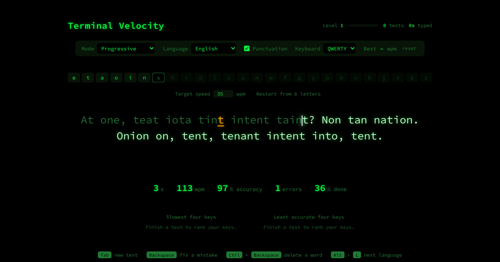

# Terminal Velocity

**A retro, green-screen touch-typing trainer for English, Ukrainian and Russian.**

Terminal Velocity teaches touch typing one letter at a time. You start with the six most common letters of a language. Each new letter unlocks only once you can type every letter you already have quickly and accurately. The text is made of real words wherever possible. The page tracks your weakest keys, so your practice goes where it's needed most.

It's a single web page with no account, no server and no tracking. It works offline, and it can be installed as an app.

## Features

- **Progressive mode.** Letters unlock in order of how often they're used in the chosen language. A letter counts as mastered when its most recent 30 presses are at least 95% accurate and at or under your target speed. Once every unlocked letter is mastered, the next one unlocks. The target speed is yours to set, in words per minute.
- **Practice aimed at weak letters.** Words containing your newest letter, or letters not yet at target, come up more often.
- **Real words first.** The texts use about 17,000 common words per language, 2–7 letters long, filtered to remove names, places, abbreviations and offensive words.
- **Made-up words that follow the spelling rules.** When your letters can't make enough real words, made-up words fill the gap. They follow each language's spelling rules: no tripled letters, only the double letters the language really uses, Russian жи-ши and ча-ща, Ukrainian ь only after д т з с ц л н, and so on.
- **Custom letters.** Practise any four letters you choose, to isolate particular keys.
- **Random word (Ukrainian).** Choose **Random word** under Mode to type one common Ukrainian word nine times. When you finish, its English meaning appears, with the stress mark shown, for example **буди́нок — house, building (noun)**. It stays on screen until you press Tab for the next word. The 3,000 words come up in random order with no repeats. These tests count towards your Ukrainian statistics and level, but not towards best speed or the letter ladder.
- **Letter drills.** For letter sets that make few words, or whenever you tick **Drills**, you get drills that use every letter equally and practise every pair of letters evenly.
- **Weakest keys.** The page shows your four slowest keys and your four least accurate keys, based on all your finished tests.
- **Levels.** You earn 1 point per second of typing and 20 points per finished test, and each level needs a little more than the last. Each language shows its own level, test count, time typed and best speed.
- **On-screen keyboard** for Ukrainian and Russian. It highlights the next key to press and dims letters you haven't unlocked yet.
- **Physical keyboard support.** With **Standard** keyboard selected, your keys are read as QWERTY for English and ЙЦУКЕН for Ukrainian or Russian, so you don't need to install another keyboard layout. **Match my system layout** uses whatever your computer types instead.
- **Export and import progress** to a file, for backups or moving to another computer.
- **A smooth gliding caret** that fits the height of the letters, and blinks at the end of a test.

## Languages

| Language | Letters | Starting letters | Keyboard |
|---|---|---|---|
| English | 26 | e t a o i n | QWERTY |
| Ukrainian (Українська) | 33, including ґ є і ї | о а н и і е | Ukrainian ЙЦУКЕН (ґ on the # key) |
| Russian (Русский) | 33 | о е а и н т | Russian ЙЦУКЕН |

Each language keeps its own progress, statistics, level and best speed.

## Keyboard shortcuts

| Keys | Action |
|---|---|
| Tab | New text with the same letters |
| Backspace | Fix a mistake |
| Ctrl + Backspace | Delete back to the start of the word |
| Alt + L | Next language (English → Ukrainian → Russian) |

## Using it

- **In a browser:** open `index.html` directly. Nothing to install, and it works offline.
- **As an app:** open the published site in Chrome or Edge, then choose **Install**. It runs in its own window with its own icon, works offline, and updates itself when a new version is published.

## Privacy and security

- **No data leaves your computer.** Your progress is saved only in your own browser's storage. There's no account, analytics or advertising, and the page makes no outside connections.
- **The font is built in**, so the page doesn't contact any font service.
- **Strict content security policy.** Only the page's own scripts and styles can run (each is pinned by a fingerprint), nothing can be loaded from elsewhere, and the page can't send data anywhere.
- **Imported progress files are checked**, and only well-formed values are accepted.
- **Hidden from search engines** (`noindex`), and no referrer information is sent.

## Files

| File | Purpose |
|---|---|
| `index.html` | The whole app: page, styles, code, word lists and vocabulary |
| `manifest.webmanifest` | App name, icon and colours, which make it installable |
| `sw.js` | Offline support |
| `icons/` | App icons |
| `.nojekyll` | Tells GitHub Pages to serve the files exactly as they are |
| `screenshot.png` | The picture above |
| `THIRD-PARTY-NOTICES.md` | Credits and licences for the word lists, vocabulary and font |

## Credits

- **English word list:** from SCOWL (Spell Checker Oriented Word Lists), © Kevin Atkinson and contributors, via the `wordlist-english` package.
- **Ukrainian–English vocabulary (Random word):** meanings from **English Wiktionary**, extracted by Wiktextract and published by kaikki.org, under CC BY-SA 4.0. The adapted vocabulary is shared under the same licence.
- **Ukrainian and Russian word lists:** derived from **wordfreq** frequency data by **Robyn Speer**, licensed under CC BY-SA 4.0. The adapted lists in this project are shared under the same licence.
- **Word filtering:** done with pymorphy3 and its Russian and Ukrainian dictionaries. They were used to build the lists and are not included here.
- **Font:** Source Code Pro © Adobe, under the SIL Open Font License 1.1.

Full notices are in [THIRD-PARTY-NOTICES.md](THIRD-PARTY-NOTICES.md).

## Licence

The licence for Terminal Velocity's own code hasn't been chosen yet. The bundled word lists and font keep their own licences, as described above.
